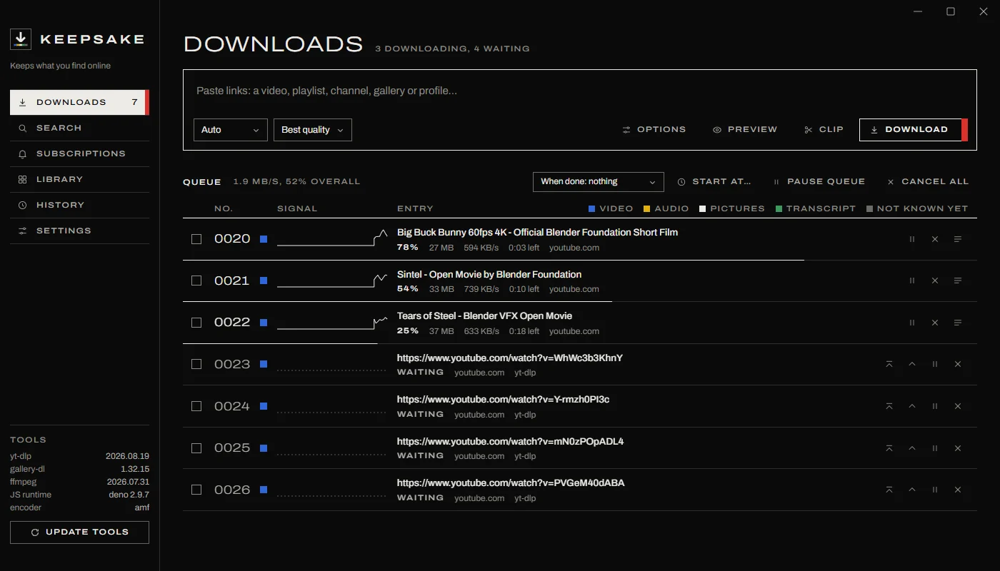
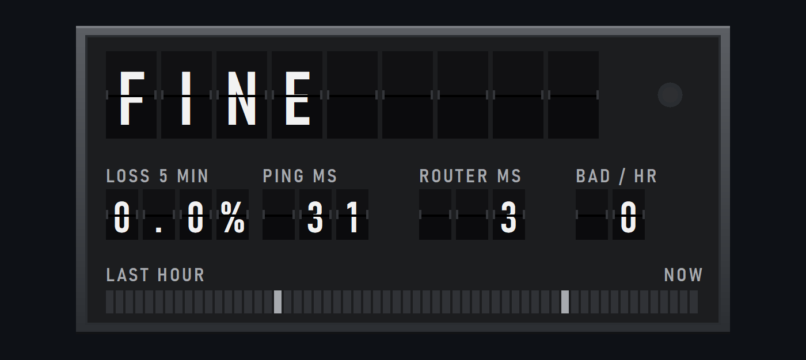
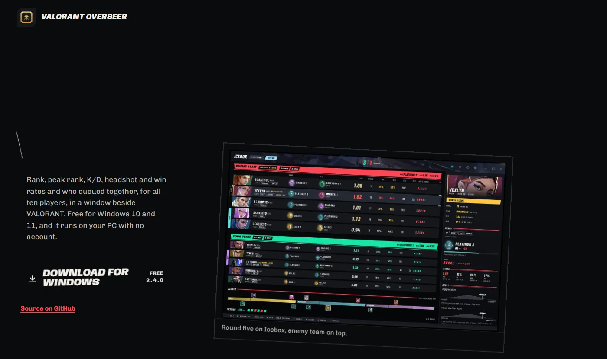

# Paul Wu

I currently work at [Backboard.io](https://backboard.io), an AI inference and model quantization company in Ottawa, Ontario, and I do both of those things, mostly on B200s, H100s and RTX 6000 Pros.

Nearly everything here runs on your own computer, and while local projects are currently all the rage, I've been building on my own systems since well before this trend. There's something beautiful about how your data can stay on your machine, continuing working when the internet or the company behind it doesn't, and nobody can change the price or take it away later. There is a great sense of freedom when one realizes that so much of what one uses can be made by themselves, and I hope that you'll share this feeling with me going through my projects. 

## switchboard

Animated pictures of what happens inside LLM inference, drawn from real runs of small public models. Every morning a workflow pushes the top Hacker News headline through a real mixture-of-experts router and redraws the banner at the top of this page. Then it explains the headline with Qwen3-1.7B and an EAGLE-3 head I trained for it, and races that against Qwen3-1.7B writing alone on GitHub's CPUs. It comes out the same text, about 1.4 times as fast. The page runs that race in your browser on your own GPU, where an RTX 4070 laptop writes about 220 tokens a second with the head guessing and 160 without it. You can also route your own sentence there, round real weights to fewer bits and read the answer out of every layer ([Site](https://somethingobvious.github.io/switchboard/), [Repo](https://github.com/SomethingObvious/switchboard)).

## jwst-peculiar

It looks for strange things in James Webb images with no labels, by ranking every tile on how far it sits from ordinary sky. A LoRA fine-tune of DINOv3 finds more planted sources than the stock model on fields it never saw, and two searches of COSMOS-Web and MINERVA, written down before any tile was scored, found nothing new. The banner is a real run on Webb's First Deep Field, and every tile lights up by its score ([Site](https://somethingobvious.github.io/jwst-peculiar/), [Repo](https://github.com/SomethingObvious/jwst-peculiar)).

## Keepsake

A free video, audio and gallery downloader for Android and Windows, built on yt-dlp and gallery-dl. This is the real interface, running a scripted queue ([Site](https://somethingobvious.github.io/keepsake/), [Repo](https://github.com/SomethingObvious/keepsake)).

## Netwatch

A small Windows desktop board that tells you when packet loss is bad enough to restart the router. This is the app's own flap animation, playing through a scripted bad hour ([Repo](https://github.com/SomethingObvious/netwatch)).

## Valorant Overseer

A VALORANT match tracker that shows every player's rank, peak and K/D, with no account and no tracking ([Site](https://somethingobvious.github.io/Valorant-Overseer/), [Repo](https://github.com/SomethingObvious/Valorant-Overseer)).

## Also Here

android-decibel-meter is a sound level meter for Android with A, C and Z weighting, Leq, noise dose and CSV logging ([Repo](https://github.com/SomethingObvious/android-decibel-meter)).

The Lab messages the coding agent on your own computer from an Android phone ([Repo](https://github.com/SomethingObvious/the-lab)).

remote-search-sms answers web searches by text, for a phone with no data and a satellite SMS plan ([Repo](https://github.com/SomethingObvious/remote-search-sms)).

Prompt-Baking bakes a system prompt into a LoRA adapter, and it fits on an 8 GB GPU ([Repo](https://github.com/SomethingObvious/Prompt-Baking)).

tiktok-activity-data-scraper turns your TikTok data export into a report of what you watch most ([Repo](https://github.com/SomethingObvious/tiktok-activity-data-scraper)).
